# CardValet

CAC and ECA card login helper for Chrome on macOS.

## How it works

When you log in to a DoD website that asks for your card, such as a .mil site, two prompts appear one after the other. CardValet handles both:

1. Chrome asks you to pick a certificate. CardValet clicks OK.
2. macOS asks for your card PIN. CardValet types the PIN you saved and presses OK.

When OpenSC is installed, CardValet checks the card before it types. If the card is locked, missing, or low on PIN retries, it stops and tells you instead of risking a lockout. Without OpenSC, CardValet still types the PIN and does not warn you. A wrong PIN can lock the card.

## Read this first

> Auto-entering a card PIN weakens the two-factor protection and may violate your organization's policy. Confirm it is allowed before you use CardValet.

- A wrong PIN counts against the card, and the card locks after a few failures. CardValet stops after one failed attempt and never presses a disabled OK button.
- Your PIN is stored only in your Apple login Keychain. It is never written to the log.
- Always check the PIN you save. CardValet cannot tell whether it is the right one until the card rejects it.

## Requirements

- macOS 13 or later and Google Chrome.
- OpenSC, so CardValet can check the card before it types. Without OpenSC, CardValet still types your PIN and does not warn you. A wrong PIN can lock the card. Install the [latest release of OpenSC](https://github.com/OpenSC/OpenSC/releases/latest), or run `brew install opensc`.

## Set up

### 1. Open the app

Double-click CardValet.app. If you like, drag it to your Applications folder first. A small card icon appears in the menu bar.

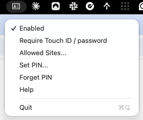

### 2. Allow Accessibility

CardValet needs Accessibility access to click the certificate dialog and type your PIN. The first time, you see this alert. Click Open Accessibility Settings.

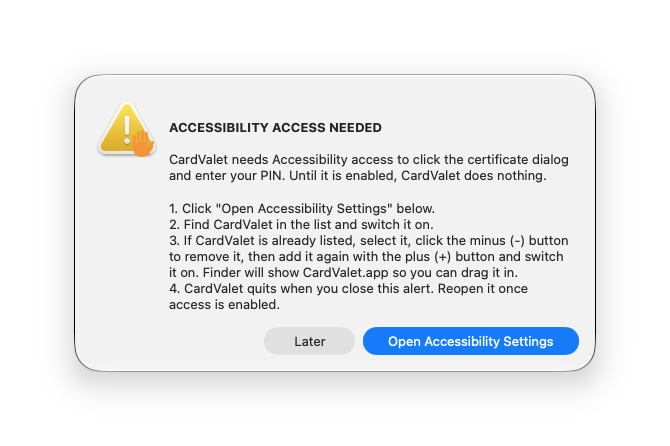

In the list, switch CardValet on. If CardValet is already listed, select it, click the minus (-) button to remove it, add it again with the plus (+) button, and switch it on. The alert shows CardValet.app in Finder so you can drag it in.

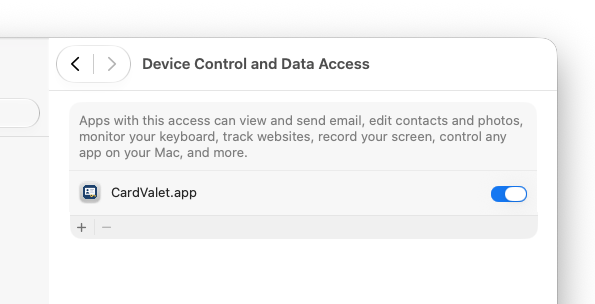

CardValet quits when you close the alert. Open it again once access is switched on.

### 3. Save your PIN

Click the card icon, then Set PIN. Enter your 4 to 8 digit card PIN twice. Tick Show PIN if you want to check what you typed.

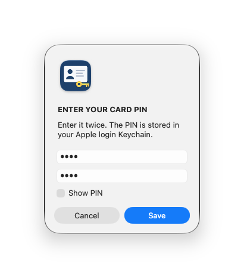

### 4. Allow Keychain access

Right after you save your PIN, macOS may ask to let CardValet read it. If you see the prompt, enter your Mac user password and choose Always Allow. It appears most often the first time you open a new copy of CardValet.app. CardValet reads the PIN at that moment on purpose, so the prompt is not hidden behind the PIN prompt later.

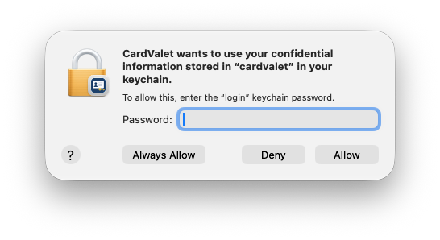

If you choose Deny, CardValet gets no PIN and types nothing. You see this prompt again after you update CardValet, because macOS treats a new copy of the app as a new app.

### 5. Log in

Open a website where Chrome shows the certificate dialog, such as a .dso.mil site. CardValet clicks OK for you if the site is in your Allowed Sites.

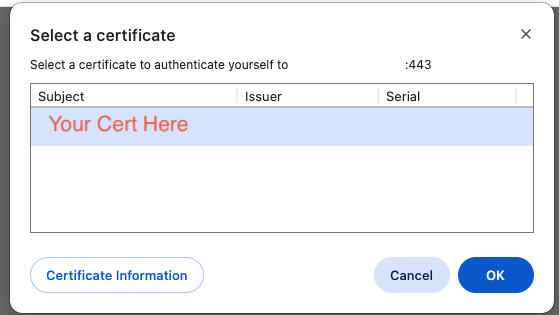

Next, macOS shows the PIN prompt. CardValet fills it in and submits it.

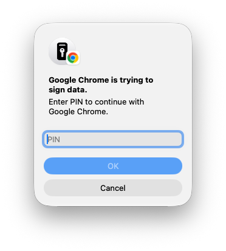

Both prompts clear without clicks. Sometimes Chrome asks for the certificate twice. That is normal.

### 6. Optional: ask for Touch ID or your password first

Turn on Require Touch ID / password in the menu if you want CardValet to check it is really you. When Chrome shows the certificate dialog, macOS asks you to confirm with Touch ID.

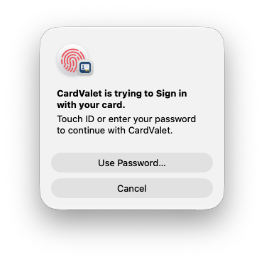

If Touch ID is not available, for example when you use your Mac with the lid closed, macOS asks for your Mac password instead.

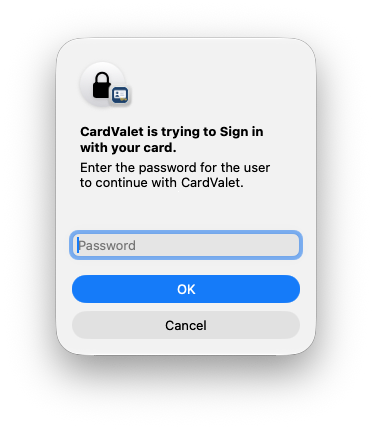

After you confirm, CardValet signs you in for the next minute. If you click Cancel, CardValet leaves the certificate dialog alone for 30 seconds.

## The menu

- Enabled: pause or resume CardValet. Turn it off if you want to handle the prompts yourself.
- Require Touch ID / password: ask for your Mac's authentication when the certificate dialog appears, before CardValet signs you in.
- Allowed Sites: choose which sites CardValet may click the certificate dialog for. See Allowed sites below.
- Set PIN: save or replace the stored PIN.
- Forget PIN: remove the stored PIN from your Keychain, after a confirmation. It is greyed out when no PIN is saved.
- Help: show this guide.
- Quit.

The icon is dimmed when CardValet is paused, red when your card is locked, and orange when no card is found.

### Forget PIN

Choose Forget PIN to remove your saved PIN from the Keychain. CardValet asks you to confirm first.

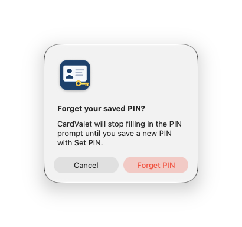

After you forget your PIN, CardValet fills in nothing until you save a new one with Set PIN. You see the No PIN saved alert if a PIN prompt appears before then.

## Allowed sites

CardValet clicks Chrome's certificate dialog only for sites in its Allowed Sites list. This stops it from acting on a dialog from an unrelated site. The default is `.dso.mil`.

- Open the card icon menu and choose Allowed Sites.

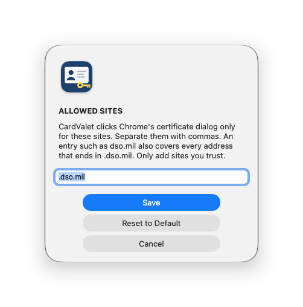

- Enter site endings separated by commas, for example `dso.mil, example.mil`. An entry such as `dso.mil` covers that site and every address that ends in `.dso.mil`.
- Entries need at least two parts. A bare `mil` or `com` is rejected as too broad.
- Reset to Default restores `.dso.mil`.
- Only add sites you trust.

The PIN prompt is not tied to a site. CardValet fills it only when the prompt says Google Chrome is signing data.

## Alerts and what to do

### Your card is locked

The card reports a locked PIN. CardValet typed nothing.

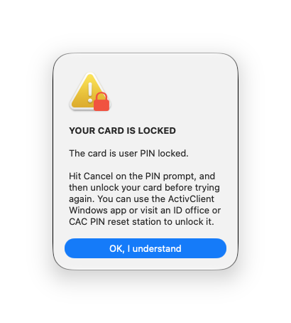

Click Cancel on the PIN prompt. Unlock the card with the ActivClient Windows app, or visit an ID office or CAC PIN reset station. Then turn Enabled back on.

### No card detected

The reader is connected but there is no card in it. CardValet typed nothing.

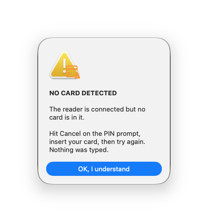

Click Cancel on the PIN prompt, insert your card, then turn Enabled back on.

### No PIN saved

A PIN prompt appeared, but you have not saved a PIN yet, so CardValet typed nothing.

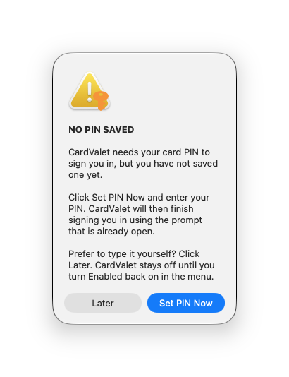

Click Set PIN Now and enter your PIN. CardValet then finishes signing you in using the prompt that is already open. Click Later if you would rather type the PIN yourself. CardValet stays off until you turn Enabled back on in the menu.

### Accessibility access needed

Shown at launch when macOS has not granted Accessibility access. This is normal after you update CardValet. Follow the steps in Set up, step 2.

### CardValet paused

- The OK button stayed disabled: the PIN did not reach the prompt, so nothing was submitted. Cancel the prompt and check the log.
- The PIN prompt came back right after submitting: the PIN may be wrong. CardValet stopped to protect your card. Cancel the prompt, fix the saved PIN with Set PIN, and turn Enabled back on.

After any alert CardValet turns itself off. Turn Enabled back on in the menu when the problem is fixed.

## Troubleshooting

- Nothing happens at login: check that the card icon is in the menu bar and Enabled is ticked. If the certificate dialog stays open, the site may not be in Allowed Sites. The log shows `is not in Allowed Sites, left alone`. Then read the log (see Diagnostics).
- The log says `accessibility trusted=false`: redo Set up, step 2.
- A small "waiting for Keychain access" window appears: macOS is asking to let CardValet read your PIN. Click Always Allow in the Keychain prompt. If you cannot see it, move the PIN prompt aside.
- CardValet shows "NO PIN SAVED" and does not type: no PIN is saved. Use Set PIN.
- The PIN is rejected: you saved the wrong PIN, or your card PIN changed. Update it with Set PIN before the next login.
- A good login shows these log lines in order: `pressed cert OK`, `cardSafe: ok=true`, `pin prompt found, typing`, `field reports N chars`, `pressed OK`.

## After you update CardValet

When you replace CardValet.app with a newer copy, macOS treats it as a new app.

- Accessibility: remove CardValet from the list with the minus button, open the app, and allow it again.
- Keychain: you may be asked again. Choose Always Allow.

## Changing your card PIN

If you change your card PIN, update the saved one first with Set PIN. Otherwise the next login sends the old PIN.

## Diagnostics

The log is at `~/Library/Logs/CardValet.log`. It never contains your PIN.

```
tail -10 ~/Library/Logs/CardValet.log
```

Run these from the folder that contains CardValet.app. Read the card status without a PIN:

```
CardValet.app/Contents/MacOS/CardValet --check-card
```

Preview the alerts without touching the card:

```
CardValet.app/Contents/MacOS/CardValet --preview-locked
CardValet.app/Contents/MacOS/CardValet --preview-nocard
CardValet.app/Contents/MacOS/CardValet --preview-accessibility
CardValet.app/Contents/MacOS/CardValet --preview-nopin
```

## Uninstall

- Quit CardValet, delete the app, and remove it from Accessibility.
- Remove the saved PIN with Forget PIN in the menu, or from Terminal:

```
security delete-generic-password -s cardvalet
```
